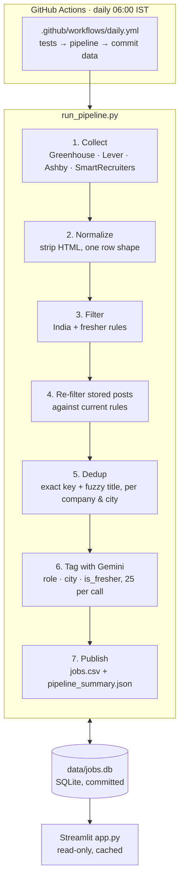

# Job Radar 📡

> A daily, terms-compliant aggregator of **fresher jobs and internships in India** (fresher = 0–2 years of experience).
> Every morning a GitHub Actions job reads ~12,200 postings from 89 companies' public job boards, keeps the India + fresher ones, removes duplicates, tags each with role / city / fresher-fit using Gemini, and publishes them to a Streamlit site. No job source needs a signup; running cost is $0.

| | |
|---|---|
| **Live app** | https://jobradar-3emp2hff2fsewrmjhx6ubp.streamlit.app/ |
| **Source code** | https://github.com/RxjxtNN/Job_Radar |
| **Demo video (Loom)** | `TODO: paste Loom link` |
| **Daily runs** | [Actions → Daily Pipeline](https://github.com/RxjxtNN/Job_Radar/actions/workflows/daily.yml) |
| **Evaluation report** | [eval/score_report.md](eval/score_report.md) |
| **Prompts** | [prompts/](prompts/) (`tag_v4.txt` is live) |
| **What broke and how it was fixed** | [WHAT_BROKE.md](WHAT_BROKE.md) (19 entries) |

---

## At a glance

| Requirement | Result |
|---|---|
| Live posts | **247** fresher posts from **57 companies** |
| Runs daily on its own | ✅ Scheduled run on 2026-11-21 succeeded with no manual trigger (see [proof](#-daily-automation-proof)) |
| Role accuracy (50-post check) | **84%** |
| City accuracy (city shown on the site) | **96%** |
| is_fresher accuracy | **82%** (precision **97%** / recall **81%**) |
| Cost per 1,000 posts | **$0.32** paid-equivalent · **$0** actual (Gemini free tier) |
| Signups needed for job data | **None** (four public ATS APIs) |

---

## 🗓️ Daily automation proof

[`.github/workflows/daily.yml`](.github/workflows/daily.yml) runs on cron `30 0 * * *` (06:00 IST) and can also be started by hand. Each run installs the dependencies, runs the 107 tests, runs the pipeline, and commits the refreshed `data/` as `github-actions[bot]`. Streamlit Cloud redeploys on every commit, so the site updates without anyone touching it.

| Run | Trigger | Result | Collected | Live after run | Bot commit |
|---|---|---|---|---|---|
| 2026-11-20 19:59 UTC | manual (first run) | ✅ success, 6m 26s | 12,220 | 246 | `33c58cc` |
| 2026-11-21 07:32 UTC | **schedule** | ✅ success | 12,192 | 247 | `0fdcf40` |

From the scheduled run's log: `107 passed` → `Found 1 untagged posts` → Gemini `HTTP/1.1 200 OK` → `tagged=1 errors=0` → `LIVE ON SITE: 247` → data committed. GitHub queued the 00:30 UTC cron for about 7 hours; scheduled workflows can start late under load, which is normal.

The site's **Last Refreshed** metric shows the timestamp of the latest pipeline run, which is how to tell whether the data is fresh.

---

## 📈 Pipeline funnel (scheduled run of 2026-11-21)

| Stage | Posts |
|---|---|
| Collected from 89 company boards (Greenhouse 52 · Lever 18 · SmartRecruiters 11 · Ashby 8) | 12,192 |
| − not in India | 10,196 |
| − not fresher by rules (senior title, or 3+ years required) | 1,664 |
| Kept this run → total stored (includes posts seen on earlier days) | 331 → 342 |
| − duplicates (same company + city; exact title, or titles ≥ 90% similar) | 21 |
| Tagged by Gemini | 321 |
| − judged not fresher by Gemini | 74 |
| **Live on the site** | **247** |

- **Live by source:** Greenhouse 99 · Lever 87 · SmartRecruiters 53 · Ashby 8.
- **Top roles:** Software Engineering 56 · Operations 50 · Customer Support 32 · HR and Recruiting 29 · Sales and BD 23 · Finance 15.
- **Top cities:** Bengaluru 147 · Mumbai 23 · Hyderabad 14 · Noida 13 · Gurugram 10.

**Finding companies.** These APIs have no "list all companies" endpoint, and only ~12% of India postings on them are open to 0–2 years of experience. Boards were found by probing ~600 company names and by web-searching for India job pages on each ATS (which surfaced slugs like `razorpaysoftwareprivatelimited` and `stable-money1`). Only boards with fresher India openings were kept. Adding a company is one line in `config.py`.

---

## 📐 Architecture



### Key design choices
1. **One definition of "live".** `db.get_live_posts()` feeds both the CSV export and the app: not expired, not a duplicate, and not tagged `is_fresher=0`. The city shown comes from the job board's location field, falling back to Gemini's city when that field is vague ("India", "Remote").
2. **No scraping or LLM calls at page load.** The app only reads SQLite over a read-only connection with a 5-minute cache, so pages load fast and cost nothing. A **🔄 Reload data** button skips the cache.
3. **Stable IDs and expiry.** Posts are keyed by `sha1(source + source_job_id)`. Seeing a post again updates its `last_seen`; a post not seen for 14 days expires.
4. **Two-layer dedup, recomputed every run.**
   - Layer 1: an exact `company|title|city` key.
   - Layer 2: rapidfuzz title similarity ≥ 90 within the same company **and city**, so the same role in Bengaluru and in Gurugram stays as two listings.
   - Recomputing every run means a hidden duplicate reappears once the post it pointed to closes.
5. **Two-stage fresher detection.**
   - *Rules* (`filters.py`) are cheap and run on all 12k posts. They reject senior titles and posts whose lowest stated requirement is 3+ years. They always accept hard entry signals (intern, trainee, graduate, pass-out), and keep generic titles with no stated requirement as candidates.
   - *Gemini* (`prompts/tag_v4.txt`) makes the final call with an ordered rule: take the **lowest** number of years the post accepts, and if it is ≤ 2 the post is a fresher post.
   - Gemini sees the opening of the description **plus every sentence about years, experience or qualifications** (`tagger.description_excerpt`). Requirements usually sit at the end of a job description, and sending only the start cut them off.
6. **Batched, cached, fail-safe tagging.**
   - 25 posts per call, with a JSON response.
   - Tags are reused by `content_hash` + prompt version, so a cross-posted job is tagged once.
   - Failed posts stay untagged and are retried next run; there are no silent "Other/Unknown" fallback tags.
   - Tagging stops after 2 consecutive failed batches, so a bad key doesn't burn quota.

---

## 📊 Evaluation & cost

**Method.** `eval/make_sample.py` draws 50 tagged posts, stratified by predicted role (seed 42). Each post was labelled independently of Gemini by reading its full description and applying the project's written definition:
- *fresher* = the lowest years of experience accepted is ≤ 2; if no years are stated, the post counts unless it clearly asks for an experienced hire;
- *role* = one of the 13 roles in `config.ROLE_LIST`;
- *city* = where the job is.

`eval/score.py` compares the labels with Gemini's tags. Labels are in [eval/sample.csv](eval/sample.csv) and the full report with every miss is in [eval/score_report.md](eval/score_report.md).

| Metric | Result |
|---|---|
| Role | **42 / 50 = 84%** |
| City (Gemini's tag) | 49 / 50 = 98% |
| City shown on site (rules first, Gemini fallback) | **48 / 50 = 96%** |
| Role and city both correct | 41 / 50 = 82% |
| is_fresher | **41 / 50 = 82%** · precision **97.2%** · recall **81.4%** |
| Cost per 1,000 posts, paid-equivalent | **$0.32** (321 posts, 145,370 input + 24,032 output tokens, `gemini-3.5-flash-lite` at $0.30 / $2.50 per 1M tokens) |
| Cost per 1,000 posts, actual | **$0** (Google AI Studio free tier) |

**What the misses show.**
- **High precision, lower recall.** When the site shows a post as fresher, it is right 97% of the time (1 false positive in 36). Most errors go the other way: Gemini hides a genuine fresher post.
- **The "2+ years" boundary is the main weakness.** 6 of the 7 hidden fresher posts ask for "2+ years" or a range starting at 2 ("2–3", "2–4", "2–5"). Prompt v4 says these count, but `flash-lite` still rejects some of them. A planned fix is a rule override: when `filters.required_min_years()` reads ≤ 2 from the text, keep the post.
- **Role misses are mostly ambiguous titles.** For example, "Interaction Designer" is speech-analytics work (tagged Design), and "Solutions Engineer" is pre-sales (tagged Software Engineering).

---

## 🤖 AI tools & prompts

| Tool | Used for |
|---|---|
| **Gemini `gemini-3.5-flash-lite`** (Google AI Studio, free tier) | Runtime tagging: role, city and is_fresher for each post, 25 per call, JSON output. The model can be changed with the `GEMINI_MODEL` env var. |
| **Claude Code** (Anthropic) | Development assistant: code review, refactoring, writing tests, debugging the pipeline and deployment, finding new company boards by web search, and labelling the evaluation sample. |

**Prompt history.** Every version is kept in [prompts/](prompts/), and bumping `PROMPT_VERSION` re-tags every post once.

| Version | Change | Why |
|---|---|---|
| `tag_v1` | Role + city, and is_fresher from a keyword list | First baseline |
| `tag_v2` | is_fresher became a question ("could a 0–1 yr graduate be hired?") with true/false rules and "when in doubt, prefer false" | Keyword matching passed too many senior posts |
| `tag_v3` | Fresher widened to 0–2 years; ranges starting at ≤ 2 allowed | Project definition changed to 0–2 years |
| `tag_v4` (live) | An ordered procedure that stops at the first rule that applies and uses the **lowest** years accepted; "prefer false" removed; examples for "1–3 yrs", "2+ yrs" and "5 to 8 yrs" | v3 hid 60% of genuine fresher posts ([WHAT_BROKE #18](WHAT_BROKE.md)) |

---

## 🗃️ Data

- **`data/jobs.db`** (SQLite, committed by the bot):
  - `posts`: id, source, company, title, url, location_raw, city, description (≤ 8,000 chars), posted_at, first_seen, last_seen, content_hash, dedup_key, duplicate_of;
  - `tags`: role, city, is_fresher, prompt_version, token counts.
- **`data/jobs.csv`**: the live posts, the same rows the app shows.
- **`data/pipeline_summary.json`**: the funnel numbers for the latest run.

### Sources and terms compliance
All job data comes from public, documented job-board APIs that companies publish so their openings can be listed elsewhere. None needs an API key or signup.

| Source | Endpoint |
|---|---|
| Greenhouse Job Board API | `boards-api.greenhouse.io/v1/boards/{company}/jobs` |
| Lever Postings API | `api.lever.co/v0/postings/{company}` |
| Ashby Job Board API | `api.ashbyhq.com/posting-api/job-board/{company}` |
| SmartRecruiters Posting API | `api.smartrecruiters.com/v1/companies/{company}/postings` |

- **Excluded:** LinkedIn, Naukri, Indeed and Internshala, because their terms forbid scraping.
- **Polite fetching:** requests send an identifying User-Agent, pause between calls, back off and retry on errors, and use a 24-hour cache.
- Details are in [sources.md](sources.md).

---

## 💻 Run it locally

```bash
git clone https://github.com/RxjxtNN/Job_Radar.git && cd Job_Radar
python -m venv venv && source venv/bin/activate
pip install -r requirements.txt
cp .env.example .env              # add GEMINI_API_KEY from https://aistudio.google.com

python run_pipeline.py --dry-run  # collect, filter, dedup, no Gemini calls
python run_pipeline.py            # full run with tagging
streamlit run app.py              # the UI
python -m pytest -q               # 107 tests
python eval/score.py              # accuracy + cost report
```

To run it in your own fork, add `GEMINI_API_KEY` as a repository secret. The workflow then runs daily, and you can also start it by hand from **Actions → Daily Pipeline → Run workflow**.

---

## 🗂️ Project layout

```
Job_Radar/
├── run_pipeline.py        # entry point: collect → filter → refilter → dedup → tag → publish
├── config.py              # every tunable: roles, fresher rules, cities, model, company lists
├── collectors/            # one file per job board (fetch + normalize), auto-discovered
│   ├── _http.py           #   shared GET with retry/back-off + 24 h disk cache
│   └── greenhouse.py  lever.py  ashby.py  smartrecruiters.py
├── normalize.py           # canonical row, HTML stripping, hashes, city extraction
├── filters.py             # India-location + fresher (0–2 yrs) rules
├── dedup.py               # exact + fuzzy dedup (same company & city), recomputed each run
├── tagger.py              # Gemini batching, validation, retry, tag reuse
├── db.py                  # SQLite schema + the single "live posts" query
├── build_site.py          # writes data/jobs.csv + data/pipeline_summary.json
├── app.py                 # Streamlit UI (read-only)
├── prompts/               # tag_v1 … tag_v4
├── eval/                  # 50-post sample, labels, scorer, report
├── tests/                 # 107 pytest tests
└── data/                  # jobs.db, jobs.csv, pipeline_summary.json (cache/ is git-ignored)
```

## 🔧 Extending
1. **Add a company**: one line in the matching list in `config.py` (`GREENHOUSE_TOKENS`, `LEVER_COMPANIES`, `ASHBY_COMPANIES`, `SMARTRECRUITERS_COMPANIES`).
2. **Add a job board**: add `collectors/<board>.py` with `fetch()` and `normalize(raw)`.
   - It is auto-discovered, and `tests/test_collectors.py` checks the contract.
   - `fetch_boards` handles caching, retries and pauses; `make_post` builds the canonical row.
3. **Add a role**: edit `ROLE_LIST` in `config.py` and the role list in a new `prompts/tag_vN.txt`, then bump `PROMPT_VERSION`.
4. **Tune rules**: edit `SENIOR_TITLE_TERMS`, `FRESHER_TITLE_SIGNALS`, `GENERIC_IC_TITLES`, `MAX_FRESHER_MIN_YEARS` and `FUZZY_THRESHOLD` in `config.py`.
5. **Switch model**: set `GEMINI_MODEL` (an env var, or a repository variable in Actions) and add its price to `MODEL_PRICING`.

## ⚠️ Known limitations
- Gemini sometimes rejects "2+ years" posts (see the evaluation); a rule override is the planned fix.
- Coverage depends on the company lists, since these APIs can't be searched across companies.
- The scheduled run can start hours late when GitHub is busy.
