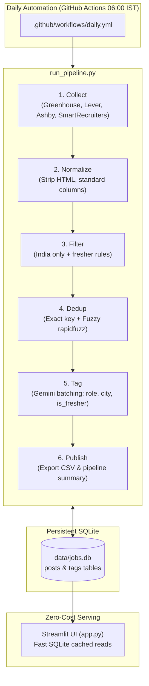

# Job Radar 📡

> Automated, terms-compliant aggregator of **fresher jobs and internships in India** (fresher = 0–2 years of experience). Each day it reads ~12,200 postings from 90 companies' public job boards, keeps the India + fresher ones, deduplicates them, tags role / city / fresher-fit with Gemini, and publishes them via GitHub Actions + Streamlit. No source needs a signup; total running cost is $0.

---

## 🔗 Live Application & Demo
- **Live Streamlit App**: `TODO: paste your https://<app>.streamlit.app link after deploying`
- **Demo Walkthrough Video (Loom)**: `TODO: paste Loom link`
- **Evaluation report**: [eval/score_report.md](eval/score_report.md) (generated by `eval/score.py` from the hand-labelled [eval/sample.csv](eval/sample.csv))
- **Prompts**: [prompts/](prompts/) — `tag_v4.txt` is live; v1–v3 kept as history
- **What broke and how it was fixed**: [WHAT_BROKE.md](WHAT_BROKE.md)

---

## 📈 Results (run of 2026-11-21)

| Stage | Posts |
|---|---|
| Collected from 90 company boards (Greenhouse 52 · Lever 19 · SmartRecruiters 11 · Ashby 8) | 12,220 |
| − not in India | 10,197 |
| − not fresher by rules (senior title, 3+ years required) | 1,684 |
| Kept → stored | 338 → 341 |
| − duplicates (same company + city, exact or ≥90% similar title) | 21 |
| Tagged by Gemini | 320 |
| − judged not fresher by Gemini | 74 |
| **Live on the site** | **246** (57 companies) |

Live by source: Greenhouse 99 · SmartRecruiters 52 · Lever 87 · Ashby 8.
Top roles live: Software Engineering 56 · Operations 50 · Customer Support 31 · HR and Recruiting 29 · Sales and Business Development 23.

**Finding companies:** these APIs have no "list all companies" endpoint, and only ~12% of India postings on them are open to 0–2 years of experience. Boards were found by probing ~600 company names and by web-searching for India job pages on each ATS (which surfaced slugs like `razorpaysoftwareprivatelimited` and `stable-money1`), then keeping only boards with fresher India openings. Adding a company is one line in `config.py`.

---

## 📐 Architecture



### Key Design Choices
0. **One definition of "live"**: `db.get_live_posts()` is used by both the CSV export and the Streamlit app (read-only connection). City shown = rule-based city from the ATS location, falling back to the LLM's city when the location is vague.
1. **Zero Runtime Scraping / LLM in Frontend**: Streamlit (`app.py`) only reads from SQLite/CSV. Page loads are instantaneous and free.
2. **Stable IDs & Expiry**: Jobs are keyed by `sha1(source + source_job_id)`. Re-seen jobs update `last_seen`; jobs older than 14 days without refresh expire automatically.
3. **Dual-Layer Deduplication**:
   - *Layer 1 (Exact)*: normalized `company|title|city`
   - *Layer 2 (Fuzzy)*: rapidfuzz title similarity (≥90) within the same company **and city** — the same role in Bengaluru and Gurugram stays as two listings
   - Duplicate links are recomputed from scratch over live posts every run, so a hidden duplicate reappears when the post it pointed to closes
4. **Two-stage fresher detection**:
   - *Rules* (`filters.py`): reject senior titles (Senior/Lead/Manager/II/III/Strategic/Enterprise…) and descriptions requiring 3+ years (fresher = 0–2 years); always accept hard entry signals (intern, trainee, graduate, pass-out); keep generic IC titles (engineer, analyst…) with no stated requirement as *candidates*.
   - *LLM* (`prompts/tag_v4.txt`): Gemini makes the final `is_fresher` call with an explicit rule — take the **lowest** years the post accepts; ≤ 2 → fresher. Posts tagged `is_fresher=0` are hidden from the app and CSV.
   - Gemini sees the opening of each description **plus every sentence about years / experience / qualifications** (`tagger.description_excerpt`), because requirements sit at the end of most JDs and a plain prefix cut them off.
5. **Batched & Cached LLM Tagging**: 25 jobs per call (the ~1.5k-token prompt is paid once per batch) with a JSON response. Tags are reused by `content_hash` + prompt version, so cross-posted jobs are tagged once. Failed or omitted posts stay untagged and are retried next run (no silent "Other/Unknown" fallback); tagging aborts after 2 consecutive batch failures so a bad key/model doesn't burn quota.

---

## 📊 Evaluation & Costs (50-Post Hand-Checked Sample)

| Metric | Measured Value | Measurement Method |
|---|---|---|
| **Role accuracy** | `TODO` (from eval/score_report.md) | 50 posts, stratified by predicted role, seed 42, hand-labelled |
| **City accuracy** (LLM tag / shown on site) | `TODO` / `TODO` | Same sample; the site shows the rule-based city first |
| **is_fresher accuracy** (precision / recall) | `TODO` (`TODO` / `TODO`) | Same sample; fresher = 0–2 years |
| **Actual cost per 1,000 posts** | **$0.00** | Gemini free tier (Google AI Studio) |
| **Paid-equivalent cost per 1,000 posts** | **$0.32** | 320 posts tagged with 142,989 input + 23,966 output tokens × `gemini-3.5-flash-lite` at $0.30 / $2.50 per 1M |

---

## 🛡️ Terms Compliance & Allowed Sources

All collection strictly adheres to robots.txt and published API terms:
- **Greenhouse Public Board API**: `boards-api.greenhouse.io` (Public ATS endpoint)
- **Lever Public Postings API**: `api.lever.co/v0/postings` (Public read JSON)
- **Ashby Job Board API**: `api.ashbyhq.com/posting-api` (Public job board API)
- **SmartRecruiters Posting API**: `api.smartrecruiters.com/v1/companies/{id}/postings` (Public, no auth)
- **No signup or API key is needed for any job source** — only `GEMINI_API_KEY` for tagging.
- **Excluded**: LinkedIn, Naukri, Indeed, and Internshala are skipped entirely due to scraping restrictions in their Terms of Service.

See detailed log: [sources.md](sources.md)

---

## 💻 Local Setup & Execution

### 1. Requirements & Setup
```bash
git clone https://github.com/<your-account>/job-radar.git
cd job-radar
python -m venv venv
source venv/bin/activate
pip install -r requirements.txt
cp .env.example .env
# Fill GEMINI_API_KEY from https://aistudio.google.com
# Optional: GEMINI_MODEL (defaults to gemini-3.5-flash-lite)
```

### 2. Run Pipeline Locally
```bash
# Run pipeline with dry-run (skips Gemini API calls)
python run_pipeline.py --dry-run

# Run full pipeline with live tagging
python run_pipeline.py
```

### 3. Launch Streamlit UI
```bash
streamlit run app.py
```

### 4. Run Tests & Validation
```bash
pytest tests/ -v
```

### 5. Run Evaluation
```bash
# Generate 50 stratified samples
python eval/make_sample.py

# Score hand-labeled sample
python eval/score.py
```

---

## 🗂️ Project Layout

```
job-radar/
├── run_pipeline.py        # entry point: collect → normalize → filter → refilter → dedup → tag → publish
├── config.py              # every tunable: roles, fresher rules, cities, model, company lists
├── collectors/            # one file per job board — fetch() + normalize(), auto-discovered
│   ├── _http.py           #   shared GET with retry/back-off + 24 h disk cache
│   ├── greenhouse.py  lever.py  ashby.py  smartrecruiters.py
├── normalize.py           # make_post() canonical row, HTML stripping, hashes, city extraction
├── filters.py             # India-location + fresher (0–2 yrs) rules
├── dedup.py               # exact + fuzzy (same company & city) dedup, recomputed each run
├── tagger.py              # Gemini batching, validation, retry, tag reuse by content hash
├── db.py                  # SQLite schema + the single "live posts" query
├── build_site.py          # exports data/jobs.csv + data/pipeline_summary.json
├── app.py                 # Streamlit UI (read-only)
├── prompts/tag_v4.txt     # current tagging prompt (older versions kept for history)
├── eval/                  # 50-post sampling + accuracy/cost scoring
├── tests/                 # pytest suite (pytest.ini puts the root on the path)
└── data/                  # jobs.db (committed), jobs.csv, cache/ (git-ignored)
```

## 🔧 Extending the Project
1. **Add a new Role Category**: Edit `ROLE_LIST` in `config.py` and the role list in `prompts/tag_v4.txt` (then bump `PROMPT_VERSION`).
2. **Add a new Source**: one file, `collectors/<source>.py`, with `fetch()` and `normalize(raw)`. It's auto-discovered (files starting with `_` are skipped), and `tests/test_collectors.py` checks the contract. `fetch_boards` handles caching, retries and pauses; `make_post` builds the canonical row (ids, hashes, city, dedup key). Sketch (check the board's real payload field names first):
   ```python
   # collectors/workable.py
   import config
   from collectors._http import fetch_boards
   from normalize import iso_date, make_post, strip_html

   SOURCE = "workable"

   def fetch():
       return fetch_boards(SOURCE, config.WORKABLE_COMPANIES,
                           "https://apply.workable.com/api/v1/widget/accounts/{slug}?details=true",
                           lambda d: d.get("jobs"), slug_field="company_slug")

   def normalize(raw):
       return make_post(SOURCE, job_id=raw.get("shortcode"), title=raw.get("title"),
                        url=raw.get("url"), company=raw["company_slug"].title(),
                        location_raw=f'{raw.get("city", "")}, {raw.get("country", "")}',
                        description=strip_html(raw.get("description") or ""),
                        posted_at=iso_date(raw.get("published_on")))
   ```
3. **Tuning Dedup**: Adjust `FUZZY_THRESHOLD` in `config.py` (default 90).
4. **Tuning fresher rules**: `SENIOR_TITLE_TERMS`, `FRESHER_TITLE_SIGNALS`, `FRESHER_DESC_SIGNALS`, `GENERIC_IC_TITLES` and `MAX_FRESHER_MIN_YEARS` in `config.py`.
5. **Changing the prompt**: add `prompts/tag_vN.txt` and bump `PROMPT_VERSION`; every post is re-tagged once under the new version.
6. **Switching model**: set `GEMINI_MODEL` (env var, or a repo *variable* in GitHub Actions) and add its price to `MODEL_PRICING`.

